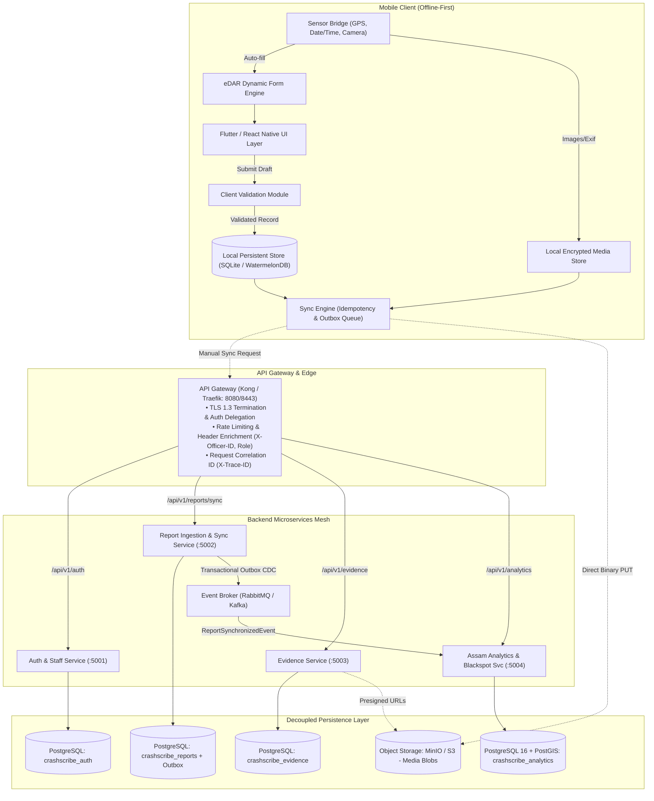
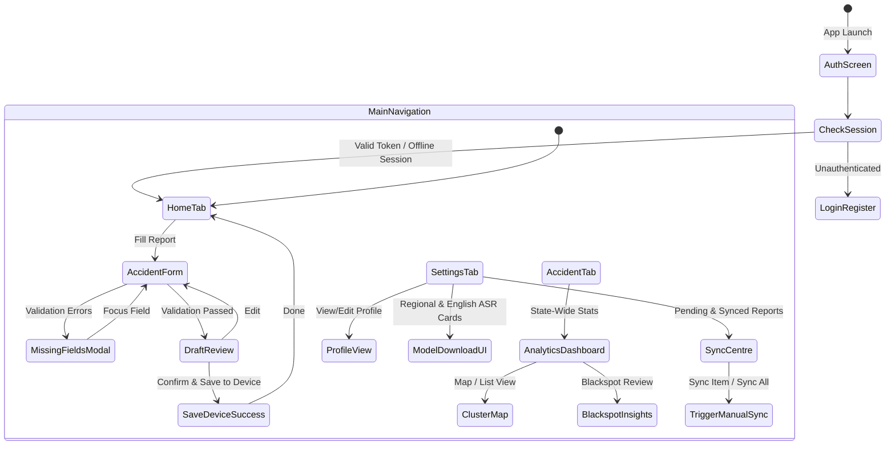
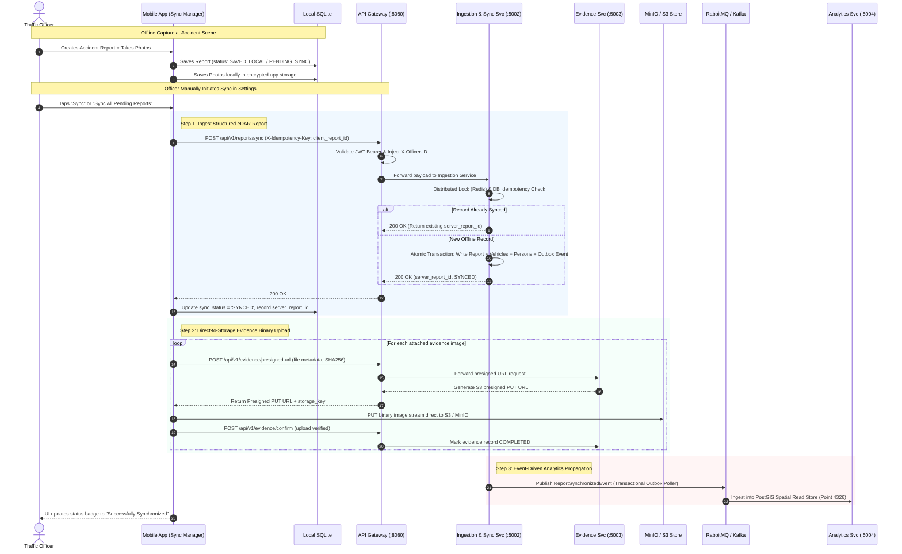
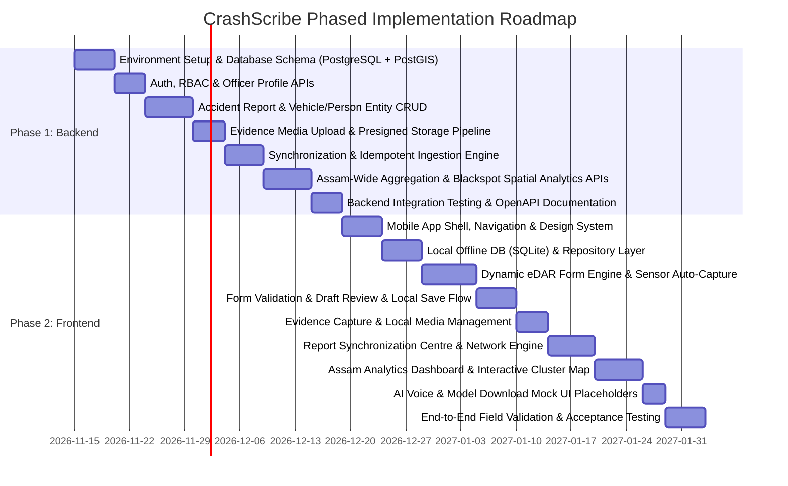

# Architecture & Technical Design Document: CrashScribe

**Project Name:** CrashScribe  
**Target Domain:** Traffic Police Accident Reporting & Investigation (Assam, India)  
**Standard Compliance:** Electronic Detailed Accident Report (eDAR) Schema  
**Status:** In Review / Ready for Implementation  

---

## 1. Executive Summary & System Objectives

**CrashScribe** is an offline-first mobile application paired with a centralized analytics backend engineered specifically for traffic police officers across Assam. The core operational environment is characterized by spotty, intermittent, or completely absent cellular connectivity at accident sites (highways, rural roads, remote intersections).

### Primary Objectives
1. **Offline-First Resilience:** Enable officers to capture comprehensive multi-vehicle, multi-casualty accident reports with 100% functionality offline. Data survives device reboots, app terminations, and network drops.
2. **Explicit / User-Controlled Synchronization:** Reports are saved locally and only dispatched to the central Assam accident database upon manual user initiation (no automatic background sync surprises or bandwidth drains at the scene).
3. **eDAR Schema Fidelity:** Match the official Ministry of Road Transport and Highways (MoRTH) eDAR reporting standards with dynamic sectioning and order toggles.
4. **Sensor Auto-Capture:** Automate capture of physical parameters (GPS lat/long, timestamps, weather/temperature where device hardware permits) while providing manual fallback and validation.
5. **Decoupled Architecture for Future AI:** Interface provisions (microphone trigger UI, model download cards for IndicConformer and Whisper/IndicTrans2) are isolated with mock contracts so future voice-to-text and translation pipelines can plug in without schema or UI rewrites.
6. **State-Wide Aggregation & Analytics:** A central data warehouse and analytics engine powering district-level heatmaps, clustering, severity trends, and Blackspot detection insights.

---

## 2. System Architecture Overview

CrashScribe implements an **offline-first client architecture** paired with a **domain-driven, event-driven microservices backend**:



---

## 3. Technology Stack Selection & Rationale

| Layer | Recommended Technology | Alternatives Considered | Rationale & Trade-offs |
| :--- | :--- | :--- | :--- |
| **Mobile Client** | **Flutter (Dart)** or **React Native + TS** | Kotlin Multiplatform, Native (Swift/Kotlin) | Cross-platform (Android/iOS) with high performance, excellent SQLite support (`sqflite` / `drift` / `WatermelonDB`), robust camera/geolocation plugins, rapid UI iteration for complex forms. |
| **Local Database** | **SQLite (via Drift / Room / WatermelonDB)** | Hive, Realm | ACID-compliant relational storage matching relational eDAR entities (Report 1-to-N Vehicles, 1-to-N Persons, 1-to-N Evidence). Enables SQL queries, foreign key cascades, and durable transactions. |
| **Backend Framework** | **Node.js (NestJS / TypeScript)** or **Go / Python (FastAPI)** | Spring Boot, Django | NestJS provides typed modular architecture, out-of-the-box OpenAPI specs, fast async I/O for file uploads and sync endpoints. |
| **Cloud Database** | **PostgreSQL 16 + PostGIS** | MySQL, MongoDB | Native geospatial querying (`ST_ClusterDBSCAN`, `ST_Distance`) for Assam accident mapping, blackspot clustering, and geo-polygon filtering by district/station. |
| **Object Storage** | **S3-compatible Storage (AWS S3 / Cloudflare R2 / MinIO)** | Local disk | Encrypted, scalable storage for high-resolution accident photos with presigned upload URLs. |
| **Authentication** | **JWT with Refresh Tokens + Argon2 / Bcrypt** | OAuth2, Firebase Auth | Secure official government logins; hashed officer credentials; district-scoped access claims embedded in JWTs. |

---

## 4. Mobile Application Architecture (Offline-First)

### 4.1. Screen & Navigation Flow



### 4.2. Form Layout & Dynamic View Ordering
To avoid officer fatigue with 100+ eDAR fields, the form is partitioned into expandable, collapsible accordions with a persistent progress indicator:
1. **Accident Information** (Date, Time, Category, Nature)
2. **Accident Location** (District, PS, Highway/Road, Landmark, Coordinates)
3. **Road & Environmental Conditions** (Surface, Weather, Geometry, Lighting)
4. **Vehicles Involved** (Dynamic 1-to-N vehicle cards)
5. **Persons Involved** (Dynamic 1-to-N person casualty cards)
6. **Accident Description** (Detailed narrative text area)
7. **Evidence & Attachments** (Camera capture, gallery, captions)

#### Field Order Toggle Mode:
- **Mode A: "Required / Practical First"**
  - Section 1: Auto-populated Sensor Parameters (Date, Time, GPS Lat/Long, Weather) with manual override.
  - Section 2: Mandatory Core Fields (District, Police Station, Collision Type, Fatalities).
  - Section 3: Vehicles & Persons.
  - Section 4: Secondary & Detailed Environmental Observations.
- **Mode B: "Official eDAR Order"**
  - Direct 1-to-1 sequential mapping according to the standard MoRTH eDAR form sections.
*Constraint:* Switching modes reorders the UI presentation dynamically without mutating the underlying reactive form state or storage schema.

### 4.3. Sensor Automation vs. Placeholders
- **Automated Sensor Ingestion:**
  - GPS Location: Uses high-accuracy device GPS (`geolocator`); populates `latitude`, `longitude`, and reverse-geocodes nearby landmark if cache available.
  - Timestamp: Auto-filled with device ISO-8601 local time with drift check against NTP when connected.
  - Environment/Weather: Optional weather API lookup cached based on location coordinates when online, fallback to manual radio buttons.
- **Voice / Speech Placeholders (Strictly Decoupled):**
  - Microphone icons placed on designated narrative text inputs.
  - *Current behavior:* Clicking the mic invokes a mock recording state (`"Listening..."`) and inserts a representative placeholder string (e.g., `"[Sample voice transcript: Head-on collision between commercial truck and motorcycle on NH-37 near Khanapara...]"`). No audio pipeline or inference is active.

### 4.4. Local Storage & Validation Engine
- **Validation Execution:** Executed on **Review Report** tap. 
- **Error Presentation:** Non-blocking bottom sheet summarizing error count, clicking an item auto-expands the specific accordion and smoothly scrolls & focuses the offending field.
- **Draft Persistence:** Unsaved work is auto-drafted into local key-value store to prevent accidental loss if the app is closed.

---

## 5. Synchronization & Conflict Architecture

### 5.1. Strict Manual Synchronization Rules
1. **Zero Auto-Sync:** No background sync worker, no sync on network connectivity re-established event, and no auto-upload upon local submit.
2. **Sync Outbox Lifecycle:**
   - `DRAFT`: In-progress form.
   - `SAVED_LOCAL` (Pending Cloud Sync): Stored in local DB, assigned UUIDv4 `client_report_id`.
   - `SYNCING`: Upload payload dispatched, awaiting server response.
   - `SYNCED`: Acknowledged by cloud, assigned `server_report_id`, synced timestamp stored.
   - `SYNC_FAILED`: Network or validation failure; local record intact, error log updated.

### 5.2. Sync Protocol & Payload Sequence

The synchronization engine implements a decoupled multi-step sequence with idempotency protection and direct-to-storage binary upload:



### 5.3. Conflict & Idempotency Strategy
- **Distributed Idempotency Guard:** Mobile clients supply `X-Idempotency-Key: <client_report_uuid>`. The Ingestion Service guards writes using a Redis distributed lock and a unique database constraint on `client_report_id`. Retried sync attempts return existing record IDs with `200 OK` without duplicating rows.
- **Report Editing Post-Sync:**
  - If an officer modifies a locally synced report, its local version increments (`version: 2`), status reverts to `PENDING_RESYNC`.
  - Re-upload includes `version` tracking and updates the cloud record, emitting an updated event through the transactional outbox with an audit trail entry.

---

## 6. Cloud Database Schemas (Database-per-Service Architecture)

Following the microservices specification in `backend.md`, each service owns its dedicated database. Direct cross-database foreign keys are prohibited; services reference entities via standard UUIDs (`officer_id`, `client_report_id`).

### 6.1. Auth Service Database (`crashscribe_auth`)
- **`officers`**: Primary identity table storing badge `official_id`, full name, contact information, hashed credentials (Argon2id / Bcrypt cost 12), district, police station, designation, and RBAC role (`SUPER_ADMIN`, `DISTRICT_SP`, `OFFICER`).
- **`refresh_tokens`**: Rotating JWT session tokens with device revocation capabilities.

### 6.2. Report Ingestion Service Database (`crashscribe_reports`)
- **`accident_reports`**: Core eDAR accident master table (`client_report_id`, `officer_id`, `schema_version`, date, time, category, nature, severity, district, police station, road name, coordinates, environmental conditions, and narrative description).
- **`vehicles` (1-to-N)**: Linked to `accident_reports(id)`, tracking `client_vehicle_id`, vehicle category, registration number, make/model, movement direction, and damage description.
- **`persons` (1-to-N)**: Linked to `accident_reports(id)` and optionally `vehicles(id)`, tracking casualty role (Driver, Passenger, Pedestrian), age, gender, injury status (`Fatal`, `Grievous`, `Minor`, `Uninjured`), and hospital.
- **`report_outbox`**: Implements the **Transactional Outbox Pattern** (`aggregate_id`, `event_type`, `payload`, `processed`), enabling safe CDC event emission to the message broker within the same atomic database transaction as report ingestion.

### 6.3. Evidence Service Database (`crashscribe_evidence`)
- **`report_evidence`**: Tracks binary scene media (`client_evidence_id`, `report_id`, `officer_id`, `storage_key`, `sha256_hash`, `file_size_bytes`, `gps_lat`, `gps_long`, and `upload_status`). Binaries reside directly in MinIO / S3 object storage.

### 6.4. Analytics & Spatial Database (`crashscribe_analytics` with PostGIS)
- **`spatial_accident_records`**: Read-optimized spatial projection holding `geom GEOMETRY(Point, 4326)` spatial coordinates, indexed via **PostGIS GIST index** (`idx_spatial_accidents_geom`).
- **`mv_potential_blackspots`**: Materialized view running spatial DBSCAN clustering:
  ```sql
  ST_ClusterDBSCAN(geom, eps := 0.005, minpoints := 3) OVER ()
  ```
  Automatically flags high-density casualty zones matching the eDAR 500m blackspot threshold.

---

## 7. Assam-Wide Analytics & Dashboard Engine

The **Accident Tab** aggregates state-level intelligence without leaking PII or raw victim credentials:

### 7.1. Aggregation Pipeline
- **Spatial Aggregation:** PostGIS spatial queries cluster accident locations for map rendering:
  ```sql
  SELECT 
      ST_AsGeoJSON(ST_Centroid(ST_Collect(location_coordinates))) as cluster_center,
      count(id) as accident_count,
      count(CASE WHEN severity = 'FATAL' THEN 1 END) as fatal_count
  FROM accident_reports
  WHERE district = :district AND accident_datetime BETWEEN :startDate AND :endDate
  GROUP BY ST_SnapToGrid(location_coordinates, 0.01);
  ```
- **Blackspot Identification Algorithm (eDAR compliant):**
  - Continuous road segment of 500m where 5 or more road accidents involving fatalities/grievous injuries occurred over the trailing 3-year window.
  - Status progression: `Under Observation` &rarr; `Potential Blackspot` &rarr; `Requires Field Verification` &rarr; `Verified by Authority`.

### 7.2. Privacy and RBAC Separation
- **Dashboard View:** Displays only anonymized, aggregated totals (counts, hot-spots, vehicle category pie charts, casualty histograms).
- **Detail View:** Access to original investigation details is restricted strictly by officer district and authorization level.

---

## 8. AI & Model Management Decoupling

The **Settings Tab** houses two mock model management cards:
1. **Model 01 — Regional Language Processing**
   - *Architecture Target:* IndicConformer INT8 (Assamese, Bengali, Bodo ASR).
   - *Displayed Footprint:* ~125 MB.
   - *UI Behavior:* Download button &rarr; simulated progress bar (0% to 100%) &rarr; `"Ready (Simulated)"`.
2. **Model 02 — English & Translation Processing**
   - *Architecture Target:* Whisper Tiny.en + IndicTrans2.
   - *Displayed Footprint:* ~190 MB.
   - *UI Behavior:* Download button &rarr; simulated progress &rarr; toggleable offline translation switch.

*Decoupling Contract:* An abstract `SpeechToTextService` interface is exposed:
```typescript
export interface SpeechToTextService {
  isModelReady(modelId: string): Promise<boolean>;
  transcribeAudio(audioPath: string, language: string): Promise<string>;
}
```
Currently instantiated via `MockSpeechToTextService` returning canned strings. The app code has zero direct bindings to ONNX Runtime, TFLite, or audio recording hardware.

---

## 9. Security, Compliance & Government Standards

1. **At-Rest Encryption:** Local SQLite database encrypted via SQLCipher using device hardware-backed Keystore/Keychain keys.
2. **In-Transit Security:** Enforced TLS 1.3 with certificate pinning on production API domains.
3. **Audit Trail:** Every edit to a submitted report creates an immutable append-only record in `sync_audit_logs`.
4. **Data Privacy (DPDP Act Compliance):** Victim and witness names, phone numbers, and identifying health documents are segregated into access-controlled tables with strict role-level masking.

---

## 10. Phased Implementation Roadmap

The project is structured into two primary delivery phases: **Phase 1: Backend Infrastructure & Services** followed by **Phase 2: Mobile Frontend & Client Integration**.



---

### Phase 1: Backend Infrastructure & Core Services

The objective of Phase 1 is to build, secure, and verify the domain-driven microservices mesh, decoupled databases, asynchronous event broker, and object storage pipeline before connecting the mobile client.

| Module | Scope & Key Deliverables | Verification & Acceptance Criteria |
| :--- | :--- | :--- |
| **1.1 API Gateway & Edge Layer (:8080 / :8443)** | - Deploy Kong / Traefik reverse proxy.<br>- Enforce TLS 1.3 termination, rate-limiting, and request correlation IDs (`X-Trace-ID`).<br>- Centralized JWT bearer validation and upstream header enrichment (`X-Officer-ID`, `X-District-ID`, `X-Station-ID`, `X-User-Role`). | Gateway blocks unauthenticated requests, throttles abusive clients, and injects validated officer claims into downstream service calls. |
| **1.2 Auth & Staff Service (:5001) & `crashscribe_auth`** | - PostgreSQL database `crashscribe_auth` schema (`officers`, `refresh_tokens`).<br>- Officer signup with official badge verification, designation, district, and police station assignment.<br>- Login with Argon2id / Bcrypt (cost 12), access JWT & refresh token rotation (`/api/v1/auth/refresh`).<br>- Profile retrieval (`GET /api/v1/auth/profile`) and update endpoints.<br>- RBAC roles: `OFFICER`, `DISTRICT_SP`, `SUPER_ADMIN`. | Auth rejects duplicate badge IDs and unauthorized registrations; password hashing verified; token revocation works as expected. |
| **1.3 Report Ingestion & Sync Service (:5002) & `crashscribe_reports`** | - PostgreSQL database `crashscribe_reports` (`accident_reports`, `vehicles`, `persons`, `report_outbox`).<br>- Support for single and batch eDAR ingestion (`POST /api/v1/reports/sync`).<br>- Multi-entity relational support (1-to-N vehicles, 1-to-N casualties with hospital and helmet/seatbelt flags).<br>- Server-side eDAR validation matching official MoRTH schema standards.<br>- **Transactional Outbox Pattern:** Atomic write of accident records and `report_outbox` event within the same database transaction. | Unit & integration tests confirm 1-to-N vehicle/person persistence, strict schema validation, and atomic outbox record creation. |
| **1.4 Distributed Idempotency Guard & Conflict Engine** | - Client-side UUID header guard (`X-Idempotency-Key: <client_report_uuid>`).<br>- Redis distributed locking to prevent concurrent double-writes.<br>- Idempotent response replay: duplicate requests return existing `server_report_id` with `200 OK` without creating duplicate rows.<br>- Report update versioning (`version: 2`) with change detection. | Automated load tests dispatch concurrent duplicate sync payloads; database maintains exactly one record and returns identical 200 responses. |
| **1.5 Evidence Service (:5003), Cloudflare R2 & `crashscribe_evidence`** | - PostgreSQL database `crashscribe_evidence` (`report_evidence`).<br>- Direct-to-storage architecture: `POST /api/v1/evidence/presigned-url` returns presigned Cloudflare R2 (S3-compatible) PUT URLs.<br>- SHA256 integrity verification and GPS metadata extraction.<br>- Confirmation endpoint `POST /api/v1/evidence/confirm` to mark evidence verified. | Mobile app uploads directly to Cloudflare R2 without loading backend memory; files validated by hash and linked to `report_id`. |
| **1.6 Event Broker & Message Distribution** | - RabbitMQ / Kafka broker setup.<br>- Outbox publisher / CDC worker polling `report_outbox` and publishing `ReportSynchronizedEvent` with at-least-once delivery semantics. | Outbox worker reliably dispatches events to message queues; dead-letter queues configured for delivery failures. |
| **1.7 Assam Analytics & Blackspot Service (:5004) & PostGIS** | - PostgreSQL 16 + PostGIS database `crashscribe_analytics` (`spatial_accident_records`).<br>- Event consumer ingesting `ReportSynchronizedEvent` and populating `geom GEOMETRY(Point, 4326)` with GIST spatial indexing.<br>- Aggregated metrics endpoint (`GET /api/v1/analytics/summary`).<br>- Geospatial clustering endpoint (`GET /api/v1/analytics/map-clusters`) with bounding box filtering.<br>- Materialized view (`mv_potential_blackspots`) running `ST_ClusterDBSCAN(geom, eps := 0.005, minpoints := 3)` to detect 500m blackspots.<br>- Time-series trends (`GET /api/v1/analytics/trends`) and strict PII redaction. | Analytics endpoints execute sub-second spatial queries across 100k+ points; clusters match DBSCAN thresholds; citizen PII is completely stripped. |
| **1.8 Backend Integration, OpenAPI & Test Suite** | - Centralized Swagger / OpenAPI 3.1 documentation accessible at `/api/docs`.<br>- Automated integration test suite validating end-to-end sync, media upload, and analytics pipelines.<br>- Comprehensive RBAC and validation rule test coverage. | 100% of core endpoints documented in OpenAPI; automated integration test suite passes green. |
| **1.9 Docker Integration & Backend Containerization** | - Production multi-stage Dockerfiles for Gateway and all 4 microservices.<br>- Complete `docker-compose.yml` orchestrating Gateway, services, PostgreSQL, Redis, and RabbitMQ.<br>- Health checks, internal networking, persistent volumes, and container smoke-test scripts. | Entire backend stack starts with a single `docker compose up --build -d`; all containers report healthy status. |

---

### Phase 2: Frontend (Mobile Application) & Client Integration

With the backend fully tested and running, Phase 2 implements the offline-first mobile client for Android and iOS, integrating with local hardware sensors and connecting to the backend via explicit synchronization.

| Module | Scope & Key Deliverables | Verification & Acceptance Criteria |
| :--- | :--- | :--- |
| **2.1 Mobile Foundation & Design System** | - App scaffolding (Flutter / React Native).<br>- Persistent bottom navigation (Home, Accident, Settings).<br>- Design system with official police-grade styling, dark/light themes, and offline/online indicator. | Persistent navigation operates smoothly; theme tokens consistent; connection status accurately reflects device network state. |
| **2.2 Local Database & Offline Repository** | - SQLite setup with encryption (SQLCipher) via Drift / WatermelonDB.<br>- Local models mirroring eDAR entities (`AccidentReport`, `Vehicle`, `Person`, `Evidence`, `SyncQueue`).<br>- Local repository interfaces supporting full offline CRUD operations. | Data persists across app process termination and full device reboots. Reports can be created, updated, and queried with zero network connectivity. |
| **2.3 Dynamic Form Engine & Sensor Auto-Capture** | - 7-section expandable accordion form.<br>- Field-order toggle: **Mode A (Required / Sensor First)** vs. **Mode B (Official eDAR Order)** without losing form state.<br>- Hardware sensor bridge: auto-fill GPS Lat/Long and timestamp with manual override fallback.<br>- Dynamic 1-to-N addition of vehicles and persons. | Toggling form order maintains all entered values; GPS and timestamp populate on tap; vehicle/person cards can be dynamically added and removed. |
| **2.4 Form Validation & Draft Review Flow** | - Validation engine triggered on "Review Report".<br>- Validation error bottom sheet with direct click-to-focus field navigation.<br>- Structured Draft Review screen summarizing all 7 sections.<br>- "Confirm and Save on Device" action: writes to local SQLite with status `SAVED_LOCAL` (Pending Cloud Sync), generates client UUID, strictly **no auto-upload**. | Missing required fields trigger summary modal and focus relevant inputs; valid report saves to local SQLite and shows local reference ID. |
| **2.5 Evidence Capture & Local Media Management** | - Camera capture and gallery selection.<br>- Image compression, thumbnail generation, and local encrypted disk storage.<br>- Image preview, removal, and optional captions.<br>- Exif GPS extraction when available. | Photos captured locally attach to report drafts; previews display correctly; media files stored persistently until synced. |
| **2.6 Report Synchronization Centre** | - Settings tab: Report Synchronization Centre with two distinct lists: **Pending Cloud Sync** and **Successfully Synchronized**.<br>- Manual triggers: Individual "Sync" button and "Sync All Pending Reports" button.<br>- Sync engine orchestrating payload upload, presigned image upload, and status transition.<br>- Failure handling preserving local records and displaying actionable errors. | Local reports only upload when user explicitly taps sync; repeat taps never duplicate cloud data; failed uploads remain in pending queue with retry option. |
| **2.7 Assam Analytics Dashboard & Interactive Map** | - Accident Tab: Central Assam Road Accident Dashboard.<br>- Metric cards (total accidents, fatal, injury, vehicles, persons).<br>- Interactive map with coordinate pins, clustering, and severity filters.<br>- Analytical breakdown charts (time-of-day, road type, weather, vehicle distribution).<br>- Blackspot insights section with status labels. | Dashboard fetches and displays cloud aggregate data; filters update map pins and charts; zero client crashes on large datasets. |
| **2.8 AI Voice & Model Management Placeholders** | - Microphone icon displayed on designated narrative text areas; tap triggers mock listening state and injects placeholder string.<br>- Settings tab: 2 hardcoded model download cards (*IndicConformer INT8* and *Whisper Tiny.en + IndicTrans2*) with simulated download progress bars.<br>- Abstract `SpeechToTextService` interface ensuring zero tight coupling to future AI runtimes. | Tapping microphone fills field with placeholder text; model cards animate simulated progress without downloading real model files or crashing. |
| **2.9 End-to-End Acceptance Testing** | - Complete walkthrough of all 16 acceptance criteria defined in the project guide.<br>- Offline stress testing (airplane mode, app kill during edit, sync retry under poor network). | Full user journey passes: officer logs in, creates report offline, reviews, saves locally, verifies pending status, triggers manual sync, and sees aggregates on the Assam dashboard. |
