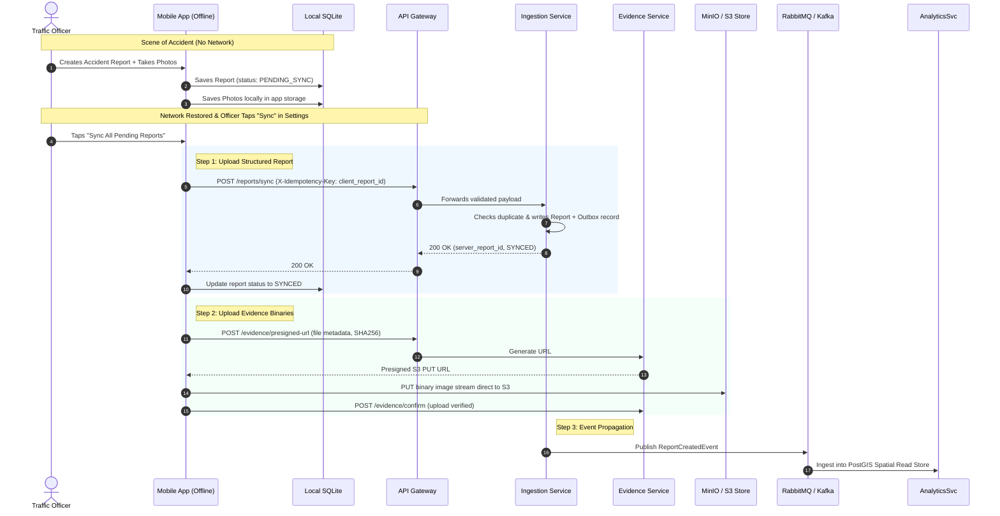

# CrashScribe — Backend Engineering & Microservices Architecture Specification

**Project:** CrashScribe  
**Document:** Backend Architecture & Implementation Guide  
**Target Domain:** Assam Police Traffic Branch (Accident Ingestion, Sync & Analytics)  
**Standard Compliance:** Electronic Detailed Accident Report (eDAR) Schema  
**Status:** Architecture Blueprint & Implementation Ready  

---

## 1. System Overview & Backend Objectives

The CrashScribe backend provides the centralized infrastructure supporting traffic police officers reporting accidents across all 35+ districts of Assam.

### Core Backend Mandates:
1. **Zero Data-Loss Offline Sync:** Ingest reports originated offline on mobile devices via idempotent, transactional sync endpoints.
2. **eDAR Schema Conformance:** Persist, validate, and index complex multi-table accident datasets according to official Ministry of Road Transport and Highways (MoRTH) standards.
3. **Decoupled Binary Storage:** Handle high-resolution scene evidence (photos, metadata) without choking transactional databases.
4. **State-Level Geospatial Aggregates:** Power the Assam Road Accident Dashboard with real-time analytics, spatial clustering, and blackspot identification via PostGIS.
5. **Strict Role-Based Security & PII Redaction:** Protect sensitive citizen and victim details from unauthorized exposure while allowing aggregated analytics for safety policy.

---

## 2. Microservices Architecture Topology

The backend is organized into domain-driven microservices exposed via a unified API Gateway:

```
                           OFFICER MOBILE APP
                                   │
                                   ▼
             ┌───────────────────────────────────────────┐
             │       API GATEWAY (Kong / Traefik)        │
             │  - TLS Termination & Reverse Proxy        │
             │  - JWT Verification & Role Injection      │
             │  - Rate Limiting & Request Throttling     │
             │  - Request Correlation ID (X-Trace-ID)    │
             └─────┬──────────────┬─────────────┬────────┘
                   │              │             │
        ┌──────────┘              │             └──────────┐
        ▼                         ▼                        ▼
┌──────────────┐          ┌──────────────┐         ┌──────────────┐
│  Auth & RBAC │          │ Report Ingest│         │   Evidence   │
│   Service    │          │  & Sync Svc  │         │   Service    │
└──────┬───────┘          └──────┬───────┘         └──────┬───────┘
       │                         │                        │
  PostgreSQL                PostgreSQL                 MinIO / S3
  (Users DB)             (eDAR Reports DB)          (Evidence Blobs)
                                 │
                                 │ (Outbox / Event Emission)
                                 ▼
                        ┌──────────────────┐
                        │   EVENT BROKER   │
                        │ (RabbitMQ/Kafka) │
                        └────────┬─────────┘
                                 │
                                 ▼
                        ┌──────────────────┐
                        │ Assam Analytics  │
                        │ & Blackspot Svc  │
                        └────────┬─────────┘
                                 │
                            PostgreSQL +
                              PostGIS
                        (Read/Spatial DB)
```

### Microservice Bounded Contexts

| Service | Port (Default) | Responsibility | Persistence |
|---|---|---|---|
| **API Gateway** | `8080` (HTTP) / `8443` | Route requests, validate JWTs, enforce rate limits | In-memory / Redis |
| **Auth & Staff Service** | `5001` | Officer signup, login, JWT refresh, stations/districts directory, RBAC | PostgreSQL (`crashscribe_auth`) |
| **Report Ingestion & Sync Service** | `5002` | Offline batch/single sync, idempotency, eDAR validations, versioning | PostgreSQL (`crashscribe_reports`) |
| **Evidence Service** | `5003` | Presigned S3/MinIO upload URLs, image verification, EXIF/GPS extraction | S3/MinIO + PostgreSQL (`crashscribe_evidence`) |
| **Assam Analytics & Blackspot Service** | `5004` | Event consumer, spatial clustering (`ST_ClusterDBSCAN`), heatmaps, blackspot alerts | PostgreSQL 16 + PostGIS (`crashscribe_analytics`) |

---

## 3. Microservices Design Patterns Applied

### 1. API Gateway & Centralized Auth Delegation
* **Boundary Validation:** The gateway checks the Bearer JWT token on all protected endpoints.
* **Header Enrichment:** It strips client headers and injects trusted upstream headers:
  * `X-Officer-ID: <uuid>`
  * `X-District-ID: <string>`
  * `X-Station-ID: <string>`
  * `X-User-Role: <SUPER_ADMIN | DISTRICT_SP | OFFICER>`
* Downstream services avoid re-hashing and re-validating JWTs independently.

### 2. Database-per-Service
* Each microservice owns its schema and database instance. 
* Direct foreign-key constraints across service boundaries are strictly forbidden. Cross-service references use UUID identifiers (`officer_id`, `client_report_id`).

### 3. Transactional Outbox Pattern & CQRS
* When the **Report Ingestion Service** saves an accident report, it writes the report and an `outbox` record within the **same atomic database transaction**.
* A background CDC/poller process publishes `ReportSynchronizedEvent` to RabbitMQ/Kafka.
* The **Analytics Service** consumes the event and writes to read-optimized spatial tables with pre-computed bounding boxes and district aggregates.

### 4. Direct-to-Storage (Presigned URLs) for Media
* Scene photographs never stream through the main API servers.
* Mobile calls `POST /api/v1/evidence/presigned-url`.
* Mobile uploads binary payloads directly to S3 / MinIO via presigned PUT URLs.
* Evidence Service registers file status after S3 upload completion or webhook notification.

### 5. Distributed Idempotency Guard
* Mobile clients supply `X-Idempotency-Key: <client_report_uuid>`.
* Ingestion Service guards writes using a Redis distributed lock and a unique database constraint on `client_report_id`.
* Retried sync attempts return existing record IDs with `200 OK` rather than duplicating rows.

---

## 4. Database Schemas (Cloud Relational Models)

### 4.1. Auth Service Database (`crashscribe_auth`)

```sql
-- Officers & Authentication
CREATE TABLE officers (
    id UUID PRIMARY KEY DEFAULT gen_random_uuid(),
    official_id VARCHAR(50) UNIQUE NOT NULL, -- e.g. AS-POL-10829
    name VARCHAR(150) NOT NULL,
    email VARCHAR(150) UNIQUE,
    phone VARCHAR(20) UNIQUE NOT NULL,
    password_hash VARCHAR(255) NOT NULL,
    district VARCHAR(100) NOT NULL,
    police_station VARCHAR(100) NOT NULL,
    designation VARCHAR(100) NOT NULL, -- Sub-Inspector, Constable, etc.
    role VARCHAR(50) NOT NULL DEFAULT 'OFFICER', -- SUPER_ADMIN, DISTRICT_SP, OFFICER
    is_active BOOLEAN DEFAULT TRUE,
    created_at TIMESTAMPTZ DEFAULT NOW(),
    updated_at TIMESTAMPTZ DEFAULT NOW()
);

CREATE TABLE refresh_tokens (
    id UUID PRIMARY KEY DEFAULT gen_random_uuid(),
    officer_id UUID REFERENCES officers(id) ON DELETE CASCADE,
    token_hash VARCHAR(255) NOT NULL,
    expires_at TIMESTAMPTZ NOT NULL,
    revoked BOOLEAN DEFAULT FALSE,
    created_at TIMESTAMPTZ DEFAULT NOW()
);
```

### 4.2. Ingestion Service Database (`crashscribe_reports`)

```sql
CREATE TYPE report_status AS ENUM ('DRAFT', 'SYNCED', 'UNDER_INVESTIGATION', 'CLOSED');

-- Core Accident Master Table
CREATE TABLE accident_reports (
    id UUID PRIMARY KEY DEFAULT gen_random_uuid(),
    client_report_id UUID UNIQUE NOT NULL, -- Client-generated UUIDv4
    officer_id UUID NOT NULL,
    schema_version VARCHAR(20) DEFAULT 'eDAR-1.0',
    
    -- Accident Information
    accident_date DATE NOT NULL,
    accident_time TIME NOT NULL,
    accident_category VARCHAR(100) NOT NULL,
    accident_nature VARCHAR(100) NOT NULL,
    severity VARCHAR(50) NOT NULL, -- Fatal, Grievous Injury, Minor Injury, Non-Injury
    
    -- Location Information
    state VARCHAR(50) DEFAULT 'Assam',
    district VARCHAR(100) NOT NULL,
    police_station VARCHAR(100) NOT NULL,
    road_name VARCHAR(200),
    landmark VARCHAR(255),
    exact_location TEXT NOT NULL,
    latitude DECIMAL(10, 8),
    longitude DECIMAL(11, 8),
    
    -- Environmental Conditions
    road_type VARCHAR(100),
    surface_condition VARCHAR(100),
    weather_condition VARCHAR(100),
    visibility VARCHAR(100),
    lighting_condition VARCHAR(100),
    
    -- Description
    accident_description TEXT NOT NULL,
    
    -- Status & Sync Meta
    status report_status DEFAULT 'SYNCED',
    synced_at TIMESTAMPTZ DEFAULT NOW(),
    created_at TIMESTAMPTZ DEFAULT NOW(),
    updated_at TIMESTAMPTZ DEFAULT NOW(),
    version INT DEFAULT 1
);

-- Vehicles Involved (1-to-N)
CREATE TABLE vehicles (
    id UUID PRIMARY KEY DEFAULT gen_random_uuid(),
    report_id UUID REFERENCES accident_reports(id) ON DELETE CASCADE,
    client_vehicle_id UUID NOT NULL,
    vehicle_category VARCHAR(100) NOT NULL,
    registration_number VARCHAR(50),
    vehicle_make_model VARCHAR(150),
    movement_direction VARCHAR(100),
    damage_description TEXT,
    created_at TIMESTAMPTZ DEFAULT NOW()
);

-- Persons Involved (1-to-N)
CREATE TABLE persons (
    id UUID PRIMARY KEY DEFAULT gen_random_uuid(),
    report_id UUID REFERENCES accident_reports(id) ON DELETE CASCADE,
    vehicle_id UUID REFERENCES vehicles(id) ON DELETE SET NULL,
    client_person_id UUID NOT NULL,
    person_role VARCHAR(100) NOT NULL, -- Driver, Passenger, Pedestrian
    name VARCHAR(150),
    age INT,
    gender VARCHAR(20),
    injury_status VARCHAR(50) NOT NULL, -- Fatal, Grievous, Minor, Uninjured
    hospital_name VARCHAR(255),
    created_at TIMESTAMPTZ DEFAULT NOW()
);

-- Transactional Outbox for Event Distribution
CREATE TABLE report_outbox (
    id UUID PRIMARY KEY DEFAULT gen_random_uuid(),
    aggregate_type VARCHAR(50) DEFAULT 'ACCIDENT_REPORT',
    aggregate_id UUID NOT NULL,
    event_type VARCHAR(100) NOT NULL, -- e.g. 'ACCIDENT_REPORT_CREATED'
    payload JSONB NOT NULL,
    processed BOOLEAN DEFAULT FALSE,
    created_at TIMESTAMPTZ DEFAULT NOW()
);
```

### 4.3. Evidence Service Database (`crashscribe_evidence`)

```sql
CREATE TABLE report_evidence (
    id UUID PRIMARY KEY DEFAULT gen_random_uuid(),
    report_id UUID NOT NULL,
    client_evidence_id UUID UNIQUE NOT NULL,
    officer_id UUID NOT NULL,
    file_name VARCHAR(255) NOT NULL,
    file_type VARCHAR(50) NOT NULL,
    file_size_bytes BIGINT NOT NULL,
    storage_key VARCHAR(500) NOT NULL, -- S3 object key
    sha256_hash VARCHAR(64) NOT NULL,
    caption TEXT,
    gps_lat DECIMAL(10, 8),
    gps_long DECIMAL(11, 8),
    upload_status VARCHAR(50) DEFAULT 'PENDING', -- PENDING, COMPLETED, FAILED
    uploaded_at TIMESTAMPTZ DEFAULT NOW()
);
```

### 4.4. Analytics & Spatial Database (`crashscribe_analytics` with PostGIS)

```sql
CREATE EXTENSION IF NOT EXISTS postgis;

CREATE TABLE spatial_accident_records (
    id UUID PRIMARY KEY,
    district VARCHAR(100) NOT NULL,
    police_station VARCHAR(100) NOT NULL,
    accident_date DATE NOT NULL,
    accident_time TIME NOT NULL,
    severity VARCHAR(50) NOT NULL,
    fatalities INT DEFAULT 0,
    injuries INT DEFAULT 0,
    vehicles_count INT DEFAULT 0,
    geom GEOMETRY(Point, 4326) NOT NULL, -- WGS84 Spatial Coordinate
    created_at TIMESTAMPTZ DEFAULT NOW()
);

CREATE INDEX idx_spatial_accidents_geom ON spatial_accident_records USING GIST(geom);
CREATE INDEX idx_spatial_accidents_district ON spatial_accident_records(district);
CREATE INDEX idx_spatial_accidents_date ON spatial_accident_records(accident_date);

-- Materialized View for Quick Blackspot Discovery
CREATE MATERIALIZED VIEW mv_potential_blackspots AS
SELECT 
    ST_Centroid(ST_Collect(geom)) AS cluster_center,
    COUNT(*) AS accident_count,
    SUM(fatalities) AS total_fatalities,
    SUM(injuries) AS total_injuries,
    district,
    'Potential Blackspot' AS classification
FROM (
    SELECT geom, district, fatalities, injuries,
           ST_ClusterDBSCAN(geom, eps := 0.005, minpoints := 3) OVER () AS cluster_id
    FROM spatial_accident_records
) clustered
WHERE cluster_id IS NOT NULL
GROUP BY cluster_id, district;
```

---

## 5. API Interface Specifications

### 5.1. Auth Service
* `POST /api/v1/auth/signup` — Officer registration with designation, district, and badge ID.
* `POST /api/v1/auth/login` — Authenticates credentials, returns `{ accessToken, refreshToken, officer }`.
* `POST /api/v1/auth/refresh` — Generates a new access token using a valid refresh token.
* `GET  /api/v1/auth/profile` — Retrieves the authenticated officer profile.
* `PUT  /api/v1/auth/profile` — Updates contact details and station assignments.

### 5.2. Report Ingestion & Sync Service
* `POST /api/v1/reports/sync` — Ingests single or batch offline reports.
  * **Header:** `X-Idempotency-Key: <uuid>`
  * **Payload:**
    ```json
    {
      "reports": [
        {
          "client_report_id": "9b1deb4d-3b7d-4bad-9bdd-2b0d7b3dcb6d",
          "accident_date": "2026-11-12",
          "accident_time": "14:30:00",
          "accident_category": "Head-on Collision",
          "accident_nature": "Fatal",
          "severity": "Fatal",
          "state": "Assam",
          "district": "Kamrup Metropolitan",
          "police_station": "Dispur",
          "exact_location": "GS Road, near Supermarket flyover",
          "latitude": 26.1445,
          "longitude": 91.7905,
          "accident_description": "Two light motor vehicles collided during heavy rainfall.",
          "vehicles": [
            {
              "client_vehicle_id": "c1f7b0a8-3561-4fa2-bc40-e2b26002f231",
              "vehicle_category": "Car / SUV",
              "registration_number": "AS-01-AB-1234",
              "movement_direction": "Northbound"
            }
          ],
          "persons": [
            {
              "client_person_id": "d8e3b2c1-8419-4b67-a2f1-6789abcdef10",
              "person_role": "Driver",
              "name": "R. Sharma",
              "age": 34,
              "gender": "Male",
              "injury_status": "Fatal"
            }
          ]
        }
      ]
    }
    ```
  * **Response:** `200 OK`
    ```json
    {
      "synced": [
        {
          "client_report_id": "9b1deb4d-3b7d-4bad-9bdd-2b0d7b3dcb6d",
          "server_report_id": "7f093122-f04b-4b13-a442-fcaee3914a1a",
          "status": "SYNCED",
          "synced_at": "2026-11-12T16:15:20Z"
        }
      ],
      "errors": []
    }
    ```

### 5.3. Evidence Service
* `POST /api/v1/evidence/presigned-url` — Requests presigned PUT URL for media uploads.
* `POST /api/v1/evidence/confirm` — Notifies backend of successful binary upload to mark evidence verified.

### 5.4. Assam Analytics & Dashboard Service
* `GET  /api/v1/analytics/summary?district=&from_date=&to_date=` — Aggregated KPIs (Total, Fatal, Injuries, Vehicles).
* `GET  /api/v1/analytics/map-clusters?bbox=minLat,minLng,maxLat,maxLng` — Geospatial clusters and heatmaps.
* `GET  /api/v1/analytics/blackspots?district=` — List of potential accident blackspots with severity indexes.
* `GET  /api/v1/analytics/trends?interval=month` — Time-series trends by district and road condition.

---

## 6. Offline-to-Cloud Sync Protocol (Client-to-Backend)



---

## 7. Security, Privacy & Government Compliance

1. **Role-Based Access Control (RBAC):**
   * `OFFICER`: Can create reports, view own submitted reports, view high-level state dashboard.
   * `DISTRICT_SP`: Can view full unmasked records within their assigned district jurisdiction.
   * `STATE_ADMIN`: Full administrative and aggregated audit access.
2. **PII Redaction on Dashboard APIs:**
   * Dashboard APIs return aggregated statistical counts, anonymized coordinates, and general crash types.
   * Personal identities (names, phone numbers, victim medical notes) are strictly excluded from analytics endpoints.
3. **Transport & Data Security:**
   * All network traffic enforced over TLS 1.3.
   * Database storage volumes encrypted at rest with AES-256.
   * Strict password hashing using Argon2id or Bcrypt with cost factor 12.

---

## 8. Deployment & Container Orchestration

### Development Environment (Docker Compose)
A complete local environment is configured in `docker-compose.yml`:
* `traefik` / `kong`: API Gateway
* `auth-service`: Port 5001
* `ingestion-service`: Port 5002
* `evidence-service`: Port 5003
* `analytics-service`: Port 5004
* `postgres-auth`, `postgres-reports`, `postgres-analytics` (with PostGIS)
* `minio`: S3-compatible local object storage
* `rabbitmq`: Event message broker

### Production Deployment (Kubernetes)
* Independent deployment pods with Horizontal Pod Autoscaling (HPA) enabled for Ingestion and Analytics.
* Secrets injected via Kubernetes Secret / Vault.
* Storage persistent volume claims (PVC) backed by cloud managed storage.

---

## 9. Developer Quickstart Guide

### Prerequisites
* Docker & Docker Compose v2+
* Node.js 20+ / Go 1.22+ / Python 3.11+ (based on microservice tech stack choice)
* PostgreSQL Client (`psql`)

### Launching the Backend Locally
```bash
# Clone the repository
git clone https://github.com/your-org/crashscribe.git
cd crashscribe

# Spin up complete microservice mesh
docker compose up -d

# Check service health
docker compose ps
curl http://localhost:8080/health
```

The CrashScribe backend architecture is structured for high fault tolerance, clean modular development, and zero-compromise data integrity under rural Indian operational constraints.
