# CrashScribe — Step-by-Step, Phase-by-Phase Implementation Workflow

**Project:** CrashScribe (Assam Police Offline-First Accident Reporting System)  
**Document:** End-to-End Development Workflow & Execution Blueprint  
**Standard Compliance:** Electronic Detailed Accident Report (eDAR) Schema  
**Structure:** Phase 1: Backend Infrastructure & Microservices &rarr; Phase 2: Mobile Application & Client Integration  

---

## 1. Workflow Architecture & Methodology

The development process follows a strict contract-driven, test-backed engineering sequence:
1. **Contract-First (OpenAPI 3.1 & Schema Definitions):** All API request/response payloads, headers, error formats, and database entities are strictly specified before coding services.
2. **Phase 1 (Backend First):** Establish, isolate, containerize, and thoroughly test the high-performance Go API Gateway, 4 microservices, transactional databases, and object storage.
3. **Phase 2 (Mobile Client & Integration):** Build the Flutter/React Native application with offline SQLite persistence, hardware sensor bridges, dynamic eDAR forms, and user-initiated sync against verified backend endpoints.

```mermaid
graph TD
    subgraph P1 ["Phase 1: Backend Infrastructure & Microservices"]
        B1["Step 1.1: Repo Structure & Local Env Setup"]
        B2["Step 1.2: Go High-Performance API Gateway"]
        B3["Step 1.3: Auth & Staff Service (:5001)"]
        B4["Step 1.4: Report Ingestion & Outbox Engine (:5002)"]
        B5["Step 1.5: Evidence & Presigned S3 Service (:5003)"]
        B6["Step 1.6: RabbitMQ Event Broker & Outbox Poller"]
        B7["Step 1.7: Assam Analytics & PostGIS Spatial Svc (:5004)"]
        B8["Step 1.8: Backend Integration & Automated Test Suite"]
        B9["Step 1.9: Docker Integration & Containerization"]
    end

    subgraph P2 ["Phase 2: Mobile Client & Integration"]
        F1["Step 2.1: Mobile Shell & Police Design System"]
        F2["Step 2.2: Encrypted Local SQLite DB (Drift / SQLCipher)"]
        F3["Step 2.3: 7-Section Dynamic eDAR Form & Sensor Bridge"]
        F4["Step 2.4: Form Validation & Draft Review & Local Save Flow"]
        F5["Step 2.5: Evidence Camera/Gallery & Local File Store"]
        F6["Step 2.6: Settings Tab - Report Sync Centre Engine"]
        F7["Step 2.7: Assam Analytics Dashboard & Interactive Cluster Map"]
        F8["Step 2.8: Mock Voice Input & Model Download Placeholders"]
        F9["Step 2.9: E2E Acceptance Testing & Offline Field Trials"]
    end

    B1 --> B2 --> B3 --> B4 --> B5 --> B6 --> B7 --> B8 --> B9
    B9 ==> F1
    F1 --> F2 --> F3 --> F4 --> F5 --> F6 --> F7 --> F8 --> F9
```



---

# PHASE 1: BACKEND INFRASTRUCTURE & SERVICES

---

### Step 1.1: Repository Monorepo Structure & Local Environment Configuration
* **Goal:** Establish a clean, modular repository layout and configure core local development databases (native PostgreSQL 16 with PostGIS and RabbitMQ broker) without requiring Docker, external S3 buckets, or Redis setup at this stage.
* **Directory Layout:**
  ```text
  backend/
  ├── api-gateway/          # High-performance Go Reverse Proxy
  ├── services/
  │   ├── auth-service/     # Officer Auth, JWT, RBAC (:5001)
  │   ├── report-service/   # Ingestion, Idempotency, Outbox (:5002)
  │   ├── evidence-service/ # Media Metadata & Local Storage (:5003)
  │   └── analytics-service/# PostGIS Aggregation & Blackspots (:5004)
  ├── shared/               # Shared proto/schema types, Go/TS middleware
  └── scripts/              # DB migration and seed scripts
  ```
* **Actions:**
  1. Initialize monorepo directory layout for all 4 microservices, gateway, and shared utilities.
  2. Setup local databases using local/native PostgreSQL 16:
     - Create databases: `crashscribe_auth`, `crashscribe_reports`, and `crashscribe_analytics`.
     - Enable PostGIS extension on `crashscribe_analytics`: `CREATE EXTENSION IF NOT EXISTS postgis;`.
  3. Configure local event broker:
     - Local RabbitMQ server running with management plugin on `5672` / `15672`.
  4. Defer Redis & S3 infrastructure:
     - Use in-memory token-bucket / DB-level unique constraint guards in place of Redis.
     - Use local disk filesystem directory (`backend/storage/uploads`) in place of S3 for early media handling.
  5. Create centralized root `.env.example` with local database connection strings and port definitions for each service.
* **Verification:** Native PostgreSQL, PostGIS, and RabbitMQ services connect successfully via CLI; local environment variables load cleanly.

---

### Step 1.2: Go High-Performance API Gateway (`:8080` / `:8443`)
* **Goal:** Build a blazingly fast edge gateway using Go to terminate TLS, enforce rate-limits, verify JWTs, and protect upstream microservices from flaky mobile network conditions.
* **Technical Stack:** Go 1.22+, `net/http/httputil.ReverseProxy`, `go-chi/chi/v5` or `gin-gonic/gin`, `golang-jwt/jwt/v5`, `redis/go-redis/v9`.
* **Actions:**
  1. Configure connection timeouts tailored for mobile connectivity:
     - `ReadTimeout: 10s`, `WriteTimeout: 15s`, `IdleTimeout: 120s` (HTTP/2 keep-alive).
  2. Implement Gateway Middleware pipeline:
     - **Correlation ID Middleware:** Injects/forwards `X-Trace-ID`.
     - **Gzip/Brotli Compression:** Compresses all responses over 1KB.
     - **Rate Limiting Middleware:** Uses Redis sliding window (100 req/min per IP/Officer).
     - **JWT Authentication Guard:** Validates Bearer tokens cryptographically.
     - **Header Enrichment:** Injects validated claims downstream:
       - `X-Officer-ID: <uuid>`
       - `X-District-ID: <string>`
       - `X-Station-ID: <string>`
       - `X-User-Role: <OFFICER | DISTRICT_SP | SUPER_ADMIN>`
  3. Reverse proxy routing table:
     - `/api/v1/auth/*` &rarr; `http://auth-service:5001`
     - `/api/v1/reports/*` &rarr; `http://report-service:5002`
     - `/api/v1/evidence/*` &rarr; `http://evidence-service:5003`
     - `/api/v1/analytics/*` &rarr; `http://analytics-service:5004`
* **Verification:** Benchmark with `wrk` or `hey`: gateway achieves <2ms latency overhead and cleanly terminates cancelled client requests via `context.Context`.

---

### Step 1.3: Auth & Staff Service (`:5001`) & `crashscribe_auth`
* **Goal:** Manage police credentials, badge validations, station directory, and secure token issuance.
* **Actions:**
  1. Execute DB migration for `officers` and `refresh_tokens`:
     - Fields: `id`, `official_id` (Unique, e.g. `AS-POL-1029`), `name`, `email`, `phone`, `password_hash`, `district`, `police_station`, `designation`, `role`, `is_active`.
  2. Implement Endpoints:
     - `POST /api/v1/auth/signup`: Validates Assam police designation, hashes password with Argon2id / Bcrypt (cost 12), ensures unique badge ID.
     - `POST /api/v1/auth/login`: Verifies credentials, returns short-lived access JWT (15 min) and long-lived refresh token (30 days).
     - `POST /api/v1/auth/refresh`: Rotates refresh token, invalidating old sessions.
     - `GET  /api/v1/auth/profile`: Returns officer station, district, and permissions.
     - `PUT  /api/v1/auth/profile`: Updates mobile phone or profile details.
* **Verification:** Unit tests confirm password hash security, rejection of duplicate badge numbers, and JWT expiry validation.

---

### Step 1.4: Report Ingestion & Sync Service (`:5002`), Redis Setup & `crashscribe_reports`
* **Goal:** Setup Redis for distributed locking, then implement idempotent eDAR ingestion, multi-table vehicle/person persistence, and the Transactional Outbox pattern.
* **Actions:**
  1. Setup & Configure Redis:
     - Install and launch local native Redis server (or managed cloud Redis) on port `6379`.
     - Configure Redis connection pool with automated retry and health check in `report-service`.
     - Implement distributed lock manager (e.g. Redlock or atomic `SET resource_name my_random_value NX PX 30000`).
  2. Execute schema migrations for `crashscribe_reports`:
     - `accident_reports` (eDAR master record, status, timestamps, version).
     - `vehicles` (1-to-N: make, model, registration, movement direction).
     - `persons` (1-to-N: casualty role, age, injury status, helmet/seatbelt).
     - `report_outbox` (`id`, `aggregate_type`, `aggregate_id`, `event_type`, `payload`, `processed`).
  3. Implement Distributed Idempotency Guard:
     - Intercept incoming `X-Idempotency-Key` or `client_report_id` using the Redis distributed lock.
     - Check database for existing `client_report_id`.
     - If the record already exists in `accident_reports`, return HTTP `200 OK` with the existing `server_report_id` immediately, bypassing re-insertion.
  4. Implement Transactional Report Ingestion (`POST /api/v1/reports/sync`):
     - Open atomic database transaction (`BEGIN`).
     - Insert `accident_reports`, `vehicles`, and `persons`.
     - Insert event `ACCIDENT_REPORT_CREATED` into `report_outbox`.
     - Commit transaction (`COMMIT`).
     - Release Redis lock and return `{ "synced": [...], "server_report_id": "..." }`.
  5. Implement Report Revisioning (`PUT /api/v1/reports/{id}`):
     - Increment `version`, track previous state in audit trail, and emit `ACCIDENT_REPORT_UPDATED` outbox record.
* **Verification:** Stress-test concurrent requests with identical `client_report_id`: Redis lock serializes traffic; database records exactly 1 entry; no duplicate vehicle or casualty rows created.

---

### Step 1.5: Evidence Service (`:5003`), Cloudflare R2 Storage & `crashscribe_evidence`
* **Goal:** Configure Cloudflare R2 (S3-compatible API) object storage and offload heavy media binaries directly to R2 buckets via presigned PUT URLs without exhausting backend memory or egress fees.
* **Actions:**
  1. Setup & Configure Cloudflare R2:
     - Provision Cloudflare R2 bucket: `crashscribe-evidence`.
     - Generate R2 S3-compatible API credentials (`R2_ACCOUNT_ID`, `R2_ACCESS_KEY_ID`, `R2_SECRET_ACCESS_KEY`).
     - Configure S3 SDK client endpoint targeting Cloudflare R2: `https://<ACCOUNT_ID>.r2.cloudflarestorage.com`.
     - Setup bucket lifecycle and CORS rules to permit direct `PUT` uploads from mobile app origins.
  2. Execute migration for `report_evidence`:
     - Fields: `id`, `report_id`, `client_evidence_id`, `officer_id`, `file_name`, `storage_key`, `sha256_hash`, `gps_lat`, `gps_long`, `upload_status`.
  3. Implement Presigned URL Generator (`POST /api/v1/evidence/presigned-url`):
     - Takes `client_evidence_id`, `file_name`, `file_size_bytes`, `sha256_hash`.
     - Validates MIME type (JPEG/PNG/HEIC only; max 15MB).
     - Generates Cloudflare R2 presigned PUT URL expiring in 15 minutes: `https://<ACCOUNT_ID>.r2.cloudflarestorage.com/crashscribe-evidence/{year}/{month}/{report_id}/{client_evidence_id}.jpg`.
     - Creates pending record in `report_evidence`.
  4. Implement Media Finalization (`POST /api/v1/evidence/confirm`):
     - Issues `HeadObject` command against Cloudflare R2 to verify object existence and file size.
     - Updates `upload_status = 'COMPLETED'`.
* **Verification:** Upload 10MB test image via generated Cloudflare R2 presigned URL; confirm file reaches R2 bucket intact and status marks `COMPLETED` with zero cloud egress charges.

---

### Step 1.6: Message Broker (RabbitMQ) & Outbox Poller CDC
* **Goal:** Reliably publish synchronized accident events to downstream analytics with at-least-once delivery semantics.
* **Actions:**
  1. Configure RabbitMQ exchanges:
     - Exchange: `crashscribe.events` (Topic Exchange).
     - Queues: `analytics.accident.ingest`, `notifications.queue`.
  2. Implement Outbox Publisher Worker (in `report-service`):
     - Periodically queries `report_outbox WHERE processed = FALSE ORDER BY created_at ASC LIMIT 100 FOR UPDATE SKIP LOCKED`.
     - Publishes payload to `crashscribe.events` with routing key `accident.created`.
     - Updates `processed = TRUE` and `processed_at = NOW()` on successful broker ACK.
  3. Configure Dead-Letter Queue (DLQ) for failed message handling.
* **Verification:** Ingest a report; verify within 500ms that the outbox record is marked `processed = TRUE` and message lands in `analytics.accident.ingest`.

---

### Step 1.7: Assam Analytics & PostGIS Spatial Service (`:5004`) & `crashscribe_analytics`
* **Goal:** Process geospatial clusters, blackspot hotspots, and high-level traffic intelligence without exposing citizen PII.
* **Actions:**
  1. PostGIS Schema & Consumer:
     - Setup table `spatial_accident_records` with `geom GEOMETRY(Point, 4326)`.
     - Consume messages from `analytics.accident.ingest` and upsert records into `spatial_accident_records`.
     - Build spatial GIST indexes on `geom` and B-tree indexes on `district` and `accident_date`.
  2. Implement Analytics Query Endpoints:
     - `GET /api/v1/analytics/summary`: Aggregate counts (total, fatal, grievous injuries, vehicles).
     - `GET /api/v1/analytics/map-clusters`: PostGIS bounding box query clustering coordinates via `ST_SnapToGrid` or `ST_ClusterDBSCAN`.
     - `GET /api/v1/analytics/blackspots`: Evaluates the eDAR 500m / 5+ severe accident criteria via spatial query and returns potential blackspot zones.
     - `GET /api/v1/analytics/trends`: Monthly/weekly severity time-series.
  3. Enforce Strict PII Redaction:
     - Exclude names, phone numbers, and identifying health descriptions from analytics responses.
* **Verification:** Insert 1,000 synthetic accident coordinates across Guwahati, Dibrugarh, and Silchar; map-cluster query returns valid GeoJSON clusters in <50ms.

---

### Step 1.8: Backend Integration & Automated Test Suite
* **Goal:** Verify end-to-end backend integrity and lock in OpenAPI contracts.
* **Actions:**
  1. Generate unified OpenAPI 3.1 specification at `http://localhost:8080/api/docs`.
  2. Create automated end-to-end integration test suite using Newman/Postman or Jest/Go test suite:
     - Officer register &rarr; Login &rarr; Ingest report &rarr; Verify outbox publication &rarr; Upload image via presigned URL &rarr; Confirm image &rarr; Verify appearance on Analytics Dashboard.
  3. Validate idempotency, duplicate protection, and RBAC boundary enforcement.
* **Verification:** 100% test pass rate on automated CI test runs.

---

### Step 1.9: Docker Integration & Backend Containerization
* **Goal:** Containerize all backend services and infrastructure into production-grade multi-stage Docker builds with unified `docker-compose.yml` orchestration for reproducible deployment.
* **Actions:**
  1. Author Multi-Stage Dockerfiles:
     - `backend/api-gateway/Dockerfile`: Multi-stage Go build (`golang:1.22-alpine` builder &rarr; distroless or scratch minimal runtime, binary size ~15MB).
     - `backend/services/auth-service/Dockerfile`: Optimized container build with non-root security user.
     - `backend/services/report-service/Dockerfile`: Optimized container build.
     - `backend/services/evidence-service/Dockerfile`: Optimized container build.
     - `backend/services/analytics-service/Dockerfile`: Optimized container build.
  2. Implement Production `docker-compose.yml`:
     - Services: `api-gateway`, `auth-service`, `report-service`, `evidence-service`, `analytics-service`.
     - Data Stores & Mesh: `postgres-auth`, `postgres-reports`, `postgres-analytics` (PostGIS), `redis`, `rabbitmq`.
     - Health checks (`HEALTHCHECK CMD ...`), internal Docker bridge network (`crashscribe-network`), and persistent volume bindings.
     - Environment variable injection via `.env` files with secret masking.
  3. Author Container Smoke Test Script:
     - Script `scripts/docker-smoke-test.sh` that spins up the container mesh, waits for health checks to turn green, runs integration smoke queries, and cleanly tears down resources.
* **Verification:** Running `docker compose up --build -d` starts the entire 5-service mesh + 5 supporting datastores without errors; `docker compose ps` reports all services healthy; API Gateway responds at `http://localhost:8080/health`.

---

# PHASE 2: MOBILE APPLICATION & CLIENT INTEGRATION

---

### Step 2.1: Mobile Foundation, Navigation & Police Design System
* **Goal:** Setup mobile project scaffolding, persistent 3-tab navigation, and police-grade design tokens.
* **Technical Stack:** Flutter 3.x (Dart) or React Native 0.74+ (TypeScript).
* **Actions:**
  1. Initialize clean architecture project structure:
     ```text
     mobile/
     ├── lib/
     │   ├── core/          # Network, theme, sensor bridge, constants
     │   ├── data/          # Local SQLite DB, repositories, sync engine
     │   ├── domain/        # eDAR models, entities, validation rules
     │   └── presentation/  # 3 Tabs: Home (Form), Accident (Map/Stats), Settings
     ```
  2. Implement Design System & Theme:
     - Professional police color palette (Dark Slate, Deep Khaki, Emergency Amber, Alert Crimson, Off-White).
     - Typography (Inter / Roboto) with high contrast for outdoor daylight legibility.
     - Persistent 3-tab bottom bar: **Home**, **Accident**, **Settings**.
     - Top App Bar with connection badge: `[ONLINE]` (Green) / `[OFFLINE MODE]` (Amber).
* **Verification:** App boots on Android/iOS; navigation tabs switch smoothly with state preservation.

---

### Step 2.2: Encrypted Local SQLite Database (SQLCipher) & Offline Repositories
* **Goal:** Build the client-side offline database ensuring reports survive app closure, battery drain, and phone reboots.
* **Actions:**
  1. Configure SQLite via `drift` / `sqflite_sqlcipher` (or `WatermelonDB`):
     - Encrypt database file at rest using device hardware Keystore/Keychain key.
  2. Create tables mirroring eDAR schema:
     - `local_accident_reports` (`client_report_id` UUID PK, `status`, `created_at`, form fields).
     - `local_vehicles` (`client_vehicle_id` PK, `client_report_id` FK, vehicle fields).
     - `local_persons` (`client_person_id` PK, `client_report_id` FK, casualty fields).
     - `local_evidence` (`client_evidence_id` PK, `client_report_id` FK, `local_file_path`, `upload_status`).
  3. Implement Repository Pattern:
     - `AccidentReportRepository`: `saveDraft()`, `finalizeLocalReport()`, `getPendingSyncReports()`, `markSynced()`.
* **Verification:** Create mock report offline; force-kill app process; relaunch app &rarr; report is completely restored from SQLite.

---

### Step 2.3: 7-Section Dynamic eDAR Form & Sensor Auto-Capture
* **Goal:** Build the complete structured accident entry form with dynamic ordering and hardware sensor automation.
* **Actions:**
  1. Build expandable accordion form sections:
     - Section 1: Accident Information (Date, Time, Category, Nature, Severity).
     - Section 2: Accident Location (State, District, PS, Road, Landmark, GPS Coordinates).
     - Section 3: Road and Environmental Conditions (Surface, Weather, Visibility, Geometry).
     - Section 4: Vehicle Information (Dynamic 1-to-N vehicle entry cards with "Add Another Vehicle").
     - Section 5: Persons Involved (Dynamic 1-to-N casualty entry cards with "Add Another Person").
     - Section 6: Accident Description (Multiline narrative text area).
     - Section 7: Evidence & Supporting Information (Camera preview and thumbnail grid).
  2. Implement Field-Order Toggle at top of form:
     - **Mode A (Required & Sensor First):** Renders GPS, time, district, core mandatory casualty fields first.
     - **Mode B (Official eDAR Order):** Re-renders fields strictly in sequential MoRTH eDAR order.
     - *State guarantee:* Switching between Mode A and Mode B does not reset or lose any user-entered values.
  3. Implement Sensor Bridge:
     - Location: Integrates `geolocator` to capture high-accuracy GPS latitude/longitude and accuracy radius.
     - Timestamp: Auto-fills ISO local date/time with manual override picker.
     - Ambient Weather: Populates weather dropdown if online cache available, otherwise manual fallback.
* **Verification:** Toggling view modes preserves inputs; GPS button locks coordinates; dynamic vehicles and casualties can be added and removed without UI lag.

---

### Step 2.4: Form Validation, Missing Fields Bottom Sheet & Draft Review
* **Goal:** Guarantee complete data integrity before allowing reports to be finalized locally.
* **Actions:**
  1. Implement Validation Engine:
     - Triggered when officer taps primary action button: **Review Report**.
     - Validates mandatory fields (Date, Time, District, Police Station, Exact Location, at least 1 Vehicle, at least 1 Person).
  2. Missing Field Handling (On Validation Failure):
     - Displays modal error summary: *"Please complete N required fields before reviewing this report."*
     - Lists all missing fields as clickable chips.
     - Tapping any chip automatically expands the corresponding accordion section, smoothly scrolls to the input, and requests focus.
  3. Draft Review Screen (On Validation Success):
     - Navigates to dedicated read-only verification view grouping all 7 sections cleanly.
     - Action 1: **Edit Report** &rarr; returns to form preserving all data.
     - Action 2: **Confirm and Save on Device** &rarr; generates UUID `client_report_id`, writes record to local SQLite with status `SAVED_LOCAL` (Pending Cloud Sync), strictly **no auto-upload**.
  4. Local Save Confirmation Screen:
     - Shows Local Reference ID, Officer ID, Saved Timestamp, and status badge *"Pending Cloud Sync"*.
* **Verification:** Attempting to review an incomplete form blocks navigation and highlights missing inputs; confirming draft saves locally and displays local reference ID.

---

### Step 2.5: Evidence Capture & Local Media Management
* **Goal:** Capture high-resolution scene evidence safely on device storage.
* **Actions:**
  1. Integrate native camera and gallery pickers (`image_picker`).
  2. Generate optimized image thumbnails for UI display while saving full-resolution file in the app’s secure sandboxed directory.
  3. Calculate SHA-256 hash and extract EXIF GPS data where present.
  4. Allow adding captions and removing unwanted photos before draft confirmation.
* **Verification:** Capture 3 photos offline; thumbnails render in Section 7; files persist in local sandboxed storage.

---

### Step 2.6: Settings Tab — Report Synchronization Centre
* **Goal:** Implement the officer-controlled manual sync engine that interfaces with Phase 1 backend services.
* **Actions:**
  1. Settings Tab UI:
     - Section A: **Officer Profile** (View badge, district, station; edit phone/email).
     - Section B: **Report Synchronization Centre** split into:
       1. **Pending Cloud Sync:** List of local reports with Local ID, accident date, location, and individual "Sync" button.
       2. **Successfully Synchronized:** List of uploaded reports with Server ID, sync date/time, and "Synced" badge.
     - Master Action: **Sync All Pending Reports** button.
  2. Synchronization Execution Rules:
     - Strict rule: **Never auto-sync** in background or upon reconnecting.
     - Upload flow:
       - Step 1: Send structured report payload to Gateway `POST /api/v1/reports/sync` with `X-Idempotency-Key`.
       - Step 2: Receive `server_report_id` and presigned URLs for each attached image.
       - Step 3: Stream image binaries directly to MinIO/S3 using presigned PUT URLs.
       - Step 4: Call `POST /api/v1/evidence/confirm`.
       - Step 5: Mark local SQLite record `status = 'SYNCED'` and record `server_report_id`.
  3. Error Handling & Retries:
     - If network drops mid-sync, preserve local records, log error reason, and allow re-sync.
     - Retrying sync never creates duplicate cloud records due to backend idempotency guard.
* **Verification:** Toggle device into Airplane Mode &rarr; attempt sync &rarr; clear network error displayed, local records safe &rarr; disable Airplane Mode &rarr; tap "Sync All" &rarr; reports transition cleanly to "Successfully Synchronized" with Server IDs.

---

### Step 2.7: Assam Analytics Dashboard & Interactive Cluster Map (Accident Tab)
* **Goal:** Allow officers to explore Assam-wide aggregated crash statistics and geospatial blackspot data.
* **Actions:**
  1. Accident Tab UI:
     - Header: Assam Road Accident Dashboard, active time-window filter, last updated timestamp.
     - KPI Metric Cards: Total Accidents, Fatal Accidents, Grievous Injuries, Vehicles Involved.
  2. Interactive Map Visualization:
     - Map view of Assam powered by MapLibre / Google Maps with offline tile caching.
     - Clustered accident pins dynamically sized by density.
     - Severity color-coding (Red = Fatal, Orange = Grievous, Yellow = Minor).
     - Tapping a pin/cluster opens aggregate summary sheet.
  3. Analytics Charts:
     - Severity distribution bar chart, accident type pie chart, time-of-day histogram.
  4. Blackspot Insights:
     - Dedicated card list highlighting potential blackspot corridors with labels (*Under Observation*, *Potential Blackspot*, *Requires Field Verification*).
  5. Multi-dimensional Filters:
     - Filter by District, Date Range, Severity, and Road Type.
* **Verification:** Changing district filter updates stats cards, map pins, and charts based solely on cloud-synchronized data.

---

### Step 2.8: Mock Voice Input & Model Download UI Placeholders
* **Goal:** Provide complete UI elements and simulated states for future AI voice-to-text without integrating heavy ML runtimes.
* **Actions:**
  1. Microphone UI Icons:
     - Display microphone icon at the right edge of eligible text fields (Accident Description, Landmark, Damage Notes).
     - Tapping microphone triggers a simulated recording bottom sheet (*"Listening in Assamese/English..."* with animated audio waveform).
     - After 2 seconds, populates field with hardcoded sample string:  
       `"[Transcribed: Commercial truck collided with motorcycle on NH-37 near Khanapara intersection.]"`
  2. Settings Tab Model Cards:
     - **Model 01 Card:** *Regional Language Processing (IndicConformer INT8 - Assamese/Bengali/Bodo ASR, 125 MB)*.
     - **Model 02 Card:** *English & Translation Processing (Whisper Tiny.en + IndicTrans2, 190 MB)*.
     - Download Button interaction: Triggers animated progress bar (0% &rarr; 100% over 3 seconds) and switches badge to *"Downloaded (Ready)"*.
  3. Architectural Isolation:
     - All interactions routed through `MockSpeechToTextService` to guarantee zero dependency on real ONNX/TFLite binaries.
* **Verification:** Tapping mic fills fields with mock text; model download buttons animate progress smoothly without network downloads or app crashes.

---

### Step 2.9: End-to-End Acceptance Testing & Offline Field Trials
* **Goal:** Verify all 16 acceptance criteria defined in the project specification under simulated rural conditions.
* **Validation Checklist:**
  - [x] **1. Auth:** Officer signup and login operate seamlessly.
  - [x] **2. Structured Entry:** Complete accident report created via manual inputs and dropdowns.
  - [x] **3. AI UI Isolation:** Voice mics and model download cards render and interact via placeholders without ML execution.
  - [x] **4. View Toggle:** Field-order toggle reorganizes layout without mutating entered data.
  - [x] **5. Validation Engine:** Missing mandatory fields detected and focused via bottom sheet.
  - [x] **6. Draft Review:** Complete review screen allows editing or saving locally.
  - [x] **7. Offline Persistence:** Report survives process termination and full phone reboot.
  - [x] **8. Zero Auto-Upload:** Confirming draft saves to local storage and does not push to cloud.
  - [x] **9. Settings Sync Hub:** Pending and Synced lists correctly display local reports.
  - [x] **10. Manual Sync:** Officer can trigger individual sync or "Sync All".
  - [x] **11. Failure Resilience:** Failed network transfers preserve local records with retry options.
  - [x] **12. Idempotency:** Repeat taps on sync never produce duplicate database records.
  - [x] **13. Dashboard Feed:** Synced reports immediately aggregate into Assam analytics.
  - [x] **14. Map & Filters:** Interactive map and charts respond dynamically to filter criteria.
  - [x] **15. Privacy & RBAC:** General dashboard redacts victim PII.
  - [x] **16. Profile & Models:** Profile editing and mock model cards operate as specified.
* **Verification:** Complete end-to-end smoke test passed on both physical Android and iOS devices.

---

## 2. Deliverable Checkpoints & Definition of Done (DoD)

| Checkpoint | Phase | DoD Criteria |
| :--- | :--- | :--- |
| **Milestone 1** | Phase 1 (Backend) | Local databases & services active; Go API Gateway reverse-proxies requests; Auth & Ingestion microservices pass automated CRUD and idempotency test suites. |
| **Milestone 2** | Phase 1 (Backend) | S3 presigned upload pipeline tested; RabbitMQ Outbox event worker operational; PostGIS spatial aggregation & blackspot endpoints verified with sub-second queries. |
| **Milestone 3** | Phase 2 (Frontend) | Mobile app UI shell, SQLite offline schema, and dynamic 7-section form operational with field-order toggle and sensor auto-capture. |
| **Milestone 4** | Phase 2 (Frontend) | Validation bottom sheet, Draft Review screen, and `SAVED_LOCAL` offline storage verified across device restarts. |
| **Milestone 5** | Phase 2 (Frontend) | Settings Sync Centre successfully connects to Phase 1 backend; manual Sync / Sync All verified with image uploads; zero duplicate records created on retries. |
| **Milestone 6** | Phase 2 (Frontend) | Assam Dashboard renders live PostGIS clusters and charts; mock voice and model cards verified; full 16-point acceptance test passed. |
